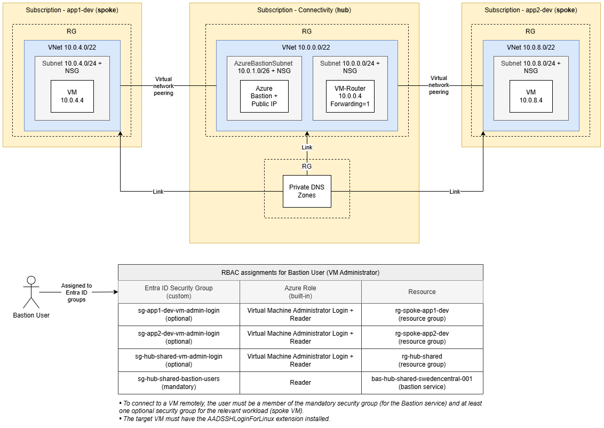

# Minimal hub-spoke topology in Azure via Bicep - part 2

Minimal hub-spoke network in Azure, built with Bicep and Azure Verified Modules (AVM). One hub VNet with a Linux VM router and two spoke VNets peered to the hub. Traffic between the spokes is routed through the hub. Compared to part 1, every subnet has an NSG, VMs register in the central Private DNS zone `hubspoke.internal`, and Azure Bastion in the hub lets you sign in to any VM with a Microsoft Entra ID account.



## Prerequisites

```powershell
winget install --exact --id Microsoft.AzureCLI
az bicep upgrade
```

The three subscriptions (connectivity, app1-dev, app2-dev) must already exist. Bicep does not create them.

## Entra ID user and groups

The templates assign the VM sign-in roles to Entra ID groups. Create the groups before deploying and set their object IDs in the param files: `bastionUsersGroupObjectId` and `vmAdminLoginGroupObjectId` in `platform/connectivity/params/shared.bicepparam`, and `vmAdminLoginGroupObjectId` in `landing-zones/app1/dev.bicepparam` and `landing-zones/app2/dev.bicepparam`. An empty ID skips that role assignment.

```powershell
az login --tenant '<tenant-id>'

$userId = az ad user create `
  --display-name "User 01" `
  --user-principal-name "user01@<tenant-domain>.onmicrosoft.com" `
  --password '<one-time-password>' `
  --force-change-password-next-sign-in true `
  --query id -o tsv

$groups = @(
  'sg-hub-shared-bastion-users',
  'sg-hub-shared-vm-admin-login',
  'sg-app1-dev-vm-admin-login',
  'sg-app2-dev-vm-admin-login'
)
foreach ($g in $groups) {
  az ad group create --display-name $g --mail-nickname $g
  az ad group member add --group $g --member-id $userId
  az ad group show --group $g --query id -o tsv   # object ID for the param files
}
```

## Deploy

```powershell
ssh-keygen -t ed25519 -f "$HOME\.ssh\azure-hub-spoke-template-02" -C "azure-hub-spoke-template-02"
$env:ADMIN_SSH_PUBLIC_KEY = Get-Content "$HOME\.ssh\azure-hub-spoke-template-02.pub"

az login --tenant '<tenant-id>'

# Hub
az account set --subscription '<hub-subscription-id>'
az deployment sub create -n hub-shared -l swedencentral -f platform/connectivity/main.bicep -p platform/connectivity/params/shared.bicepparam

# Update subscriptionId in platform/hub.bicep, then deploy the spokes.

# Spoke app1
az account set --subscription '<app1-subscription-id>'
az deployment sub create -n spoke-app1-dev -l swedencentral -f landing-zones/main.bicep -p landing-zones/app1/dev.bicepparam

# Spoke app2
az account set --subscription '<app2-subscription-id>'
az deployment sub create -n spoke-app2-dev -l swedencentral -f landing-zones/main.bicep -p landing-zones/app2/dev.bicepparam
```

## Test

```powershell
# Routing and name resolution across spokes: expect 10.0.8.4
az vm run-command invoke -g rg-spoke-app1-dev -n vm-conntest-app1-dev-swedencentral-001 --command-id RunShellScript --scripts "ping -c 4 vm-conntest-app2-dev-swedencentral-001.hubspoke.internal"
```

To test sign-in, sign in to the Azure portal as the test user, open a VM, then select **Connect** → **Bastion**, set the authentication type to **Microsoft Entra ID**, and select **Connect**.

## Clean up

Bastion is the most expensive part (about $140/month). Delete it and its public IP, and set `deployBastion = false` in `platform/connectivity/params/shared.bicepparam` so the next hub deployment doesn't recreate it.

```powershell
az network bastion delete -g rg-hub-shared -n bas-hub-shared-swedencentral-001 --subscription '<hub-subscription-id>'
az network public-ip delete -g rg-hub-shared -n pip-bas-hub-shared-swedencentral-001 --subscription '<hub-subscription-id>'
```

Or delete everything:

```powershell
az group delete -n rg-spoke-app1-dev --yes --subscription '<app1-subscription-id>'
az group delete -n rg-spoke-app2-dev --yes --subscription '<app2-subscription-id>'
az group delete -n rg-hub-shared --yes --subscription '<hub-subscription-id>'
az group delete -n rg-dns-shared --yes --subscription '<hub-subscription-id>'
```
